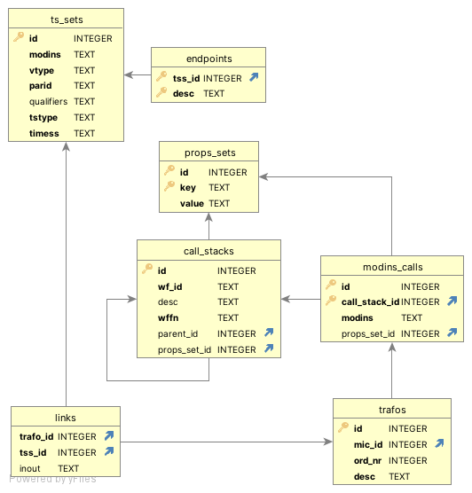

# FEWSVisualiser: Insights for optimized Delft-FEWS configurations.

A differerent approach to the analysis and visualisation of Delft-FEWS configuration

This project is a successor of https://github.com/HKV-products-services/FEWS_Netwerkvisualisation

HKV project
RO1122.10.00 Herstructurering analyse netwerkvisualisatie

## aantekeningen



2024-02-11

Zie explore. Waarom zijn er 5 call stacks met wf_DebietBerekening?

2024-02-12

Die call stacks zijn wsl goed. Elke module binnen een wf krijgt namelijk een eigen call stack en dat is terecht. Alleen dit deel moet even goed anders: de volgorde van het aanroepen van modules binnen en wf is van belang wanneer er temporaries worden doorgegeven naar een volgende module. Dit is een case die nu nog niet ondersteund wordt.

De betere manier is om in de call stacks per wf vanuit de descriptor de volgorde van modins call vast te leggen. Temporaries kunnen dan op een andere manier door gegeven worden en hoeven niet de database in.

## How to run?

```bash
pixi install
```

```bash
pixi run analyse_config {path_to_config} {path_to_db}
# eg.g
pixi run analyse_config  "..\FEWS Digiflow\Config" "db\digiflow.db3"
```
