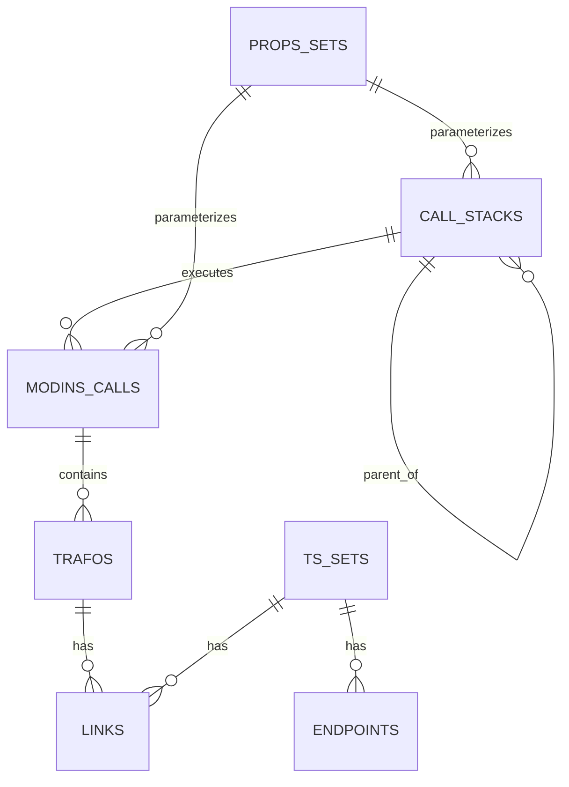
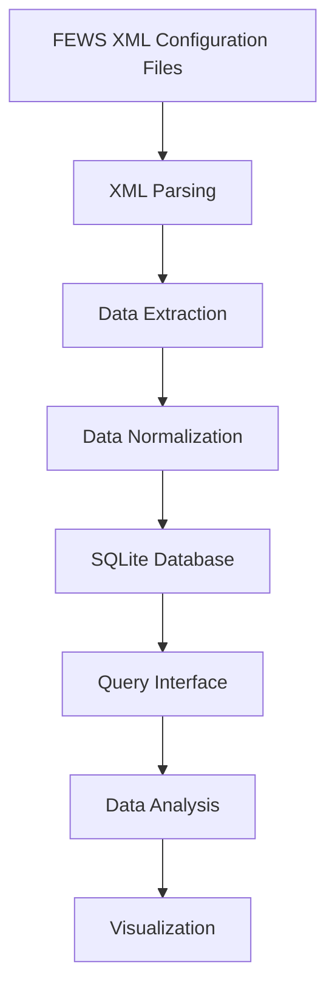

# FEWS Network Visualization: Technical Document

## 1. Project Overview

FEWS Network Visualization is a tool designed to analyze and visualize Delft-FEWS configuration. Delft-FEWS (Flood Early Warning System) is a hydrological forecasting and water management system developed by Deltares. This tool serves as a successor to the previous [FEWS_Netwerkvisualisation](https://github.com/HKV-products-services/FEWS_Netwerkvisualisation) project.

The primary goals of this project are:
- Ingest Delft-FEWS configuration structures into a SQLite database
- Provide functions to analyze the configuration data
- Visualize the relationships between different components (TimeSeriesSets, Transformations, etc.)
- Enable users to better understand complex FEWS configurations
- Ultimately integrate with an intelligent language model to provide conversational interaction with FEWS configurations

The tool is particularly valuable for FEWS administrators and developers who need to:
- Understand existing configuration structures
- Optimize complex workflows
- Debug configuration issues
- Document system architecture

## 2. Repository Architecture

The repository follows a modular structure designed to separate concerns and provide clear organization:

```
fews-networkvisualisation/
├── fewsvisualiser/         # Main Python package
│   ├── core/               # Core functionality
│   │   ├── dbconfigvis.py  # Database interaction
│   │   ├── fewsparsers.py  # XML configuration parsers
│   │   └── helpers.py      # Utility functions
│   ├── __init__.py         # Package initialization
│   ├── __main__.py         # Entry point
│   ├── analyse.py          # Analysis functions
│   └── explore.py          # Exploration utilities
├── tests/                  # Test suite
├── db/                     # Database storage directory
├── doc/                    # Documentation
├── notebooks/              # Jupyter notebooks for analysis
├── configvis.ipynb         # Jupyter notebook for analysis
├── pyproject.toml          # Project configuration
├── ConfigVisDatamodel.png  # Data model visualization
├── README.md               # Project readme
└── scope.md                # Project scope definition
```

### Key Components

| Component | Description |
|-----------|-------------|
| **fewsvisualiser/core/dbconfigvis.py** | Handles all SQLite database operations, including schema creation, data insertion, and querying |
| **fewsvisualiser/core/fewsparsers.py** | Contains parsers for various FEWS configuration XML files, extracting relevant information |
| **fewsvisualiser/core/helpers.py** | Utility functions for common operations used throughout the codebase |
| **fewsvisualiser/analyse.py** | Implements analysis functions to extract insights from the database |
| **fewsvisualiser/explore.py** | Provides exploration utilities for interacting with the parsed data |
| **notebooks/** | Collection of analysis notebooks including tools for network visualization and endpoint analysis |

## 3. Data Model

The system uses an SQLite database to store the parsed FEWS configuration data. The data model represents the complex relationships between different components in a FEWS configuration.

### Core Entities

1. **Properties Sets** (`props_sets`): Configuration properties that parameterize other components
2. **Call Stacks** (`call_stacks`): Workflow call hierarchies
3. **Module Instance Calls** (`modins_calls`): Individual module instances executed within workflows
4. **TimeseriesSets** (`ts_sets`): Sets of time series data used in transformations
5. **Transformations** (`trafos`): Data transformation operations
6. **Links** (`links`): Connections between transformations and timeseries sets
7. **Endpoints** (`endpoints`): Final output points for timeseries sets

### Entity Relationships



### Detailed Database Schema

#### `call_stacks` Table
| Column | Type | Constraints | Description |
|--------|------|-------------|-------------|
| id | INTEGER | PRIMARY KEY, NOT NULL | Call stack identifier |
| wf_id | TEXT | NOT NULL | Workflow ID |
| desc | TEXT | | Description of the workflow |
| wffn | TEXT | NOT NULL | Workflow filename |
| parent_id | INTEGER | | Parent call stack ID (self-reference) |
| props_set_id | INTEGER | | Foreign key to props_sets |

#### `endpoints` Table
| Column | Type | Constraints | Description |
|--------|------|-------------|-------------|
| tss_id | INTEGER | PRIMARY KEY, NOT NULL | Time series set ID |
| desc | TEXT | PRIMARY KEY, NOT NULL | Endpoint description |

#### `links` Table
| Column | Type | Constraints | Description |
|--------|------|-------------|-------------|
| trafo_id | INTEGER | NOT NULL | Transformation ID |
| tss_id | INTEGER | NOT NULL | Time series set ID |
| inout | TEXT | | Direction ('in' or 'out') |

#### `modins_calls` Table
| Column | Type | Constraints | Description |
|--------|------|-------------|-------------|
| id | INTEGER | PRIMARY KEY, NOT NULL | Module instance call ID |
| call_stack_id | INTEGER | PRIMARY KEY, NOT NULL | Call stack ID |
| modins | TEXT | NOT NULL | Module instance name |
| props_set_id | INTEGER | | Foreign key to props_sets |

#### `props_sets` Table
| Column | Type | Constraints | Description |
|--------|------|-------------|-------------|
| id | INTEGER | PRIMARY KEY, NOT NULL | Properties set ID |
| key | TEXT | PRIMARY KEY, NOT NULL | Property key |
| value | TEXT | NOT NULL | Property value |

#### `trafos` Table
| Column | Type | Constraints | Description |
|--------|------|-------------|-------------|
| id | INTEGER | PRIMARY KEY, NOT NULL | Transformation ID |
| mic_id | INTEGER | NOT NULL | Module instance call ID |
| ord_nr | INTEGER | NOT NULL | Order number |
| desc | TEXT | NOT NULL | Transformation description |

#### `ts_sets` Table
| Column | Type | Constraints | Description |
|--------|------|-------------|-------------|
| id | INTEGER | PRIMARY KEY, NOT NULL | Time series set ID |
| modins | TEXT | NOT NULL | Module instance name |
| vtype | TEXT | NOT NULL | Value type |
| parid | TEXT | NOT NULL | Parameter ID |
| qualifiers | TEXT | | Qualifiers (e.g., location) |
| tstype | TEXT | NOT NULL | Time series type |
| timess | TEXT | NOT NULL | Time step |
| mic_id | INTEGER | | Module instance call ID |

### Key Relationships

- call_stacks.parent_id → call_stacks.id (many-to-one)
- call_stacks.props_set_id → props_sets.id (many-to-one)
- endpoints.tss_id → ts_sets.id (many-to-one)
- links.tss_id → ts_sets.id (many-to-one)
- links.trafo_id → trafos.id (many-to-one)
- modins_calls.call_stack_id → call_stacks.id (many-to-one)
- modins_calls.props_set_id → props_sets.id (many-to-one)
- trafos.mic_id → modins_calls.id (many-to-one)

## 4. Data Flow from FEWS Configuration to Visualization

The process of transforming FEWS configuration into visualizations follows these key steps:

### 4.1 Data Ingestion Flow



### 4.2 Detailed Processing Steps

1. **XML Configuration Loading**:
   - The system reads XML configuration files from a FEWS configuration directory
   - XML files are parsed using the ElementTree library

2. **Parsing and Extraction**:
   - `TimeseriesSetParser` extracts timeseries metadata
   - Workflow configurations are parsed to determine call hierarchies
   - Transformations are extracted with their input/output relationships

3. **Database Population**:
   - Extracted data is normalized and inserted into the SQLite database
   - Relationships between entities are established through foreign keys

4. **Visualization Generation**:
   - Database queries retrieve specific views of the configuration
   - Visualization code in the Jupyter notebook generates diagrams
   - Example diagrams focus on timeseries sets and transformations

## 5. Key SQL Queries for Configuration Analysis

The system uses a variety of SQL queries to extract information from the database. These queries form the foundation of the analysis and visualization capabilities.

### 5.1 Finding Transformations

```sql
-- Find transformations by name pattern
SELECT id, desc, mic_id 
FROM trafos 
WHERE desc LIKE '%debiet%'
```

### 5.2 Finding Time Series Sets

```sql
-- Find time series sets by parameter pattern
SELECT id, modins, vtype, parid, qualifiers, tstype, timess
FROM ts_sets 
WHERE parid LIKE '%WNS%'
```

### 5.3 Tracing Data Flow

```sql
-- Find transformations that produce a given time series (upstream dependencies)
SELECT t.id, t.desc, t.mic_id
FROM trafos t
JOIN links l ON t.id = l.trafo_id
WHERE l.tss_id = 336 AND l.inout = 'out'

-- Find transformations that consume a given time series (downstream impacts)
SELECT t.id, t.desc, t.mic_id
FROM trafos t
JOIN links l ON t.id = l.trafo_id
WHERE l.tss_id = 336 AND l.inout = 'in'
```

### 5.4 Complex Analysis Queries

```sql
-- Find all transformations with multiple inputs, ordered by input count
SELECT t.id, t.desc, COUNT(l.tss_id) as input_count
FROM trafos t
JOIN links l ON t.id = l.trafo_id
WHERE l.inout = 'in'
GROUP BY t.id
HAVING COUNT(l.tss_id) > 1
ORDER BY input_count DESC

-- Identify all workflows affected by a time series
SELECT DISTINCT cs.id, cs.wf_id, cs.desc
FROM call_stacks cs
JOIN modins_calls mc ON cs.id = mc.call_stack_id
JOIN trafos t ON mc.id = t.mic_id
JOIN links l ON t.id = l.trafo_id
WHERE l.tss_id = 336

-- Find "dead points" - time series sets that are neither used as inputs nor endpoints
SELECT ts.id, ts.modins, ts.parid, ts.qualifiers, ts.tstype, ts.timess
FROM ts_sets ts
WHERE ts.id NOT IN (
    -- TSS used as inputs for transformations
    SELECT DISTINCT tss_id 
    FROM links 
    WHERE inout = 'in'
)
AND ts.id NOT IN (
    -- TSS marked as endpoints
    SELECT tss_id 
    FROM endpoints
)
ORDER BY ts.modins, ts.parid
```

### 5.5 Exploring the Database

```sql
-- List available transformations
SELECT id, desc, mic_id
FROM trafos
ORDER BY id
LIMIT 20

-- List available time series sets
SELECT id, modins, parid, qualifiers
FROM ts_sets
ORDER BY id
LIMIT 20

-- List available workflows
SELECT id, wf_id, desc
FROM call_stacks
WHERE parent_id IS NULL  -- Only top-level workflows
ORDER BY id
LIMIT 20

-- Find endpoints (final outputs)
SELECT e.tss_id, e.desc, ts.parid, ts.qualifiers
FROM endpoints e
JOIN ts_sets ts ON e.tss_id = ts.id
```

## 6. Database Schema and Parsers

### 6.1 Database Schema

The SQLite database schema consists of the following tables as described in section 3.

#### Primary and Foreign Key Relationships

The database uses foreign keys to establish relationships between tables:

- `call_stacks.parent_id` references `call_stacks.id` to create the workflow hierarchy
- `call_stacks.props_set_id` references `props_sets.id` to link workflows to their properties
- `modins_calls.call_stack_id` references `call_stacks.id` to link module calls to workflows
- `modins_calls.props_set_id` references `props_sets.id` to link module calls to properties
- `trafos.mic_id` references `modins_calls.id` to link transformations to module calls
- `links.trafo_id` references `trafos.id` to link transformations to their connections
- `links.tss_id` references `ts_sets.id` to link time series sets to connections
- `endpoints.tss_id` references `ts_sets.id` to identify time series sets that are final outputs

### 6.2 Key Parsers

The system employs several parsers to extract information from FEWS configuration files:

#### TimeseriesSetParser
Responsible for parsing timeseries set definitions from XML configuration files. Its key functions include:
- `parse_timestep_id_file`: Parses timestep definitions
- `parse_tss`: Extracts timeseries set metadata including module instance, value type, parameter ID, and qualifiers

#### WorkflowParser
Handles the parsing of workflow configurations, extracting:
- Workflow descriptors
- Module instance calls within workflows
- Call hierarchies and their relationships

#### TransformationParser
Processes transformation definitions, identifying:
- Transformation types
- Input and output connections to timeseries sets
- Transformation parameters and configurations

## 7. Current Capabilities

The current version of the FEWS Network Visualization tool offers several key capabilities:

### 7.1 Configuration Parsing and Storage
- Parse FEWS XML configuration files into a structured SQLite database
- Extract and store relationships between different configuration components
- Maintain referential integrity between related entities

### 7.2 Configuration Analysis
- Query complex relationships between workflows, modules, and timeseries
- Analyze data flow through transformation chains
- Identify endpoints and data sources

### 7.3 Visualization Examples

The tool currently supports two main visualization approaches:

#### TimeSeriesSet-Focused View
```mermaid
graph LR
  subgraph flow [ ]
    tf_out[Transformation(s) Out] --> ts_set[Timeseries Set] --> tf_in[Transformation(s) In]
  end
  subgraph final [ ]
    endpoint[Endpoint]
    ts_set --> endpoint
  end
```

This visualization shows:
- A specific timeseries set and its metadata
- Transformations that produce this timeseries set
- Transformations that consume this timeseries set
- Any endpoints associated with the timeseries set

#### Transformation-Focused View
```mermaid
graph LR
  subgraph flow [ ]
    ts_in[TimeseriesSet(s) In] --> tf[Transformation] --> ts_out[TimeseriesSet(s) Out]
  end
  callstack[Call stack] --> modin[ModIns_Call]
  subgraph modin
    tf
  end
```

This visualization shows:
- A specific transformation and its description
- Input timeseries sets consumed by the transformation
- Output timeseries sets produced by the transformation
- The module instance call containing the transformation
- The call stack context

### 7.4 Query Capabilities

The system supports a wide variety of queries for analyzing FEWS configurations, including:

| Query Type | Description | Example SQL |
|------------|-------------|------------|
| Find by Pattern | Find transformations or time series matching name patterns | `SELECT * FROM trafos WHERE desc LIKE '%debiet%'` |
| Upstream Dependencies | Find transformations that produce a time series | `SELECT * FROM trafos t JOIN links l ON t.id = l.trafo_id WHERE l.tss_id = Y AND l.inout = 'out'` |
| Downstream Impacts | Find transformations that consume a time series | `SELECT * FROM trafos t JOIN links l ON t.id = l.trafo_id WHERE l.tss_id = Y AND l.inout = 'in'` |
| Multi-Input Transformations | Find transformations with multiple input time series | `SELECT t.id, t.desc, COUNT(l.tss_id) as count FROM trafos t JOIN links l ON t.id = l.trafo_id WHERE l.inout = 'in' GROUP BY t.id HAVING count > 1` |
| Workflow Impact | Identify workflows affected by a time series | `SELECT DISTINCT cs.id, cs.wf_id, cs.desc FROM call_stacks cs JOIN modins_calls mc ON cs.id = mc.call_stack_id JOIN trafos t ON mc.id = t.mic_id JOIN links l ON t.id = l.trafo_id WHERE l.tss_id = X` |
| Endpoints | Find endpoints for a timeseries set | `SELECT * FROM endpoints e JOIN ts_sets ts ON e.tss_id = ts.id` |
| Call Stack Hierarchy | Trace workflow call hierarchies | `SELECT * FROM call_stacks WHERE parent_id = Z` |

## 8. Practical Insights from Runtime Analysis

Testing and analysis of real FEWS configurations have revealed important aspects of how Delft-FEWS operates and how transformations interrelate in production environments. These insights, gathered from analyse.py, explore.py, and their log files, provide valuable context for understanding FEWS configurations.

### 8.1 Transformation Networks in FEWS

Unlike simple linear data flows, FEWS configurations typically implement complex networks of transformations with intricate dependencies:

#### Real-World Example:
Analysis of a real-world configuration revealed:

- A single time series set (TSS ID 336: parameter "WNS2366" from "GenerateProcesOverzichtTimeseries") is used as input by 26 different transformations, including:
  - Discharge calculations for different locations (Boezem_debiet_wic, Gouda_debiet_wic)
  - Multiple chloride load calculations for various locations (Chloridevracht.Katwijk, Chloridevracht.Spaarndam, etc.)
  - Data merging operations (Merge_locaties)
  - Flow aggregations (totaal debieten in, totaal debieten uit)

- Transformation chains form a network rather than a simple pipeline:
  - Output from one transformation often feeds multiple downstream processes
  - Key parameters create fan-out effects across the system
  - Changes to one parameter can have ripple effects throughout the configuration

#### Hierarchical Organization
Transformations in FEWS are organized hierarchically:
- Transformations belong to module instance calls (e.g., "GenerateProcesOverzichtTimeseries", "Aggregaties")
- Module instance calls belong to workflows (e.g., "ProcesOverzicht", "Import_Data")
- Workflows can call other workflows, creating complex execution trees

This multi-level organization allows for sophisticated water modeling but requires tools like FEWS Network Visualization to comprehend fully.

### 8.2 Error Handling and Robustness

The parsers in fewsparsers.py have been enhanced to handle various error conditions:

- Missing XML elements are detected and reported with clear error messages
- Critical components like timeSeriesSet elements are validated before processing
- Parameter validation prevents propagation of invalid data through the system

These improvements ensure the tool can process real-world FEWS configurations that may have inconsistencies or specialized structures.

### 8.3 System Operation

The system's operation demonstrates several practical aspects:

#### Data Analysis Process
1. **Configuration Parsing**: The `analyse_config` function in analyse.py:
   - Processes XML configuration files
   - Extracts relationships between workflows, transformations, and time series
   - Populates the SQLite database with structured data

2. **Data Exploration**: The `explore_config` function in explore.py:
   - Queries the database to expose relationships
   - Shows which transformations use specific time series
   - Traces backwards from endpoints to source data

#### Logging Infrastructure
The system implements robust logging to track its operation:
- Log files are created for both analysis and exploration phases
- Files are cleaned before each run to provide clear output
- Detailed error messages help diagnose issues with configurations

#### Database Structure in Practice
The database design effectively captures the complex relationships in real FEWS configurations:
- Links table shows the intricate network of dependencies
- Call stacks trace the execution hierarchy
- Time series sets form the connective tissue between transformations

## 9. Future Directions

The repository is positioned for several key enhancements:

### 9.1 Language Model Integration
The ultimate goal is to integrate an intelligent language model to enable conversational interaction with FEWS configuration and data. This would allow users to:
- Ask natural language questions about configuration
- Get explanations of complex workflows
- Identify potential configuration issues
- Receive recommendations for optimization

We've prepared a database schema description suitable for LLM integration, making it easier to generate SQL queries from natural language questions.

### 9.2 Enhanced Visualization
Future work could include:
- Interactive web-based visualizations
- More comprehensive views of the configuration
- Custom filtering and exploration tools
- Real-time updates as configuration changes

### 9.3 Performance Optimizations
For large FEWS configurations, potential improvements include:
- Optimized database queries
- Incremental updates to avoid full reprocessing
- Parallel processing of configuration files

### 9.4 Analytic Notebooks
We've developed several Python notebooks in the `notebooks/` directory:
- `fews_network_analysis.py`: General purpose analysis of FEWS configurations
- `find_multi_input_transformations.py`: Specialized analysis of transformations with multiple inputs
- `analyze_endpoints.py`: Analysis of final outputs in the FEWS configuration
- `extract_db_schema.py`: Utilities for extracting database schema information
- `llm_ready_schema.py`: Tools for preparing database schema for LLM integration

## 10. Conclusion

The FEWS Network Visualization repository provides a solid foundation for analyzing and visualizing Delft-FEWS configurations. By ingesting configuration data into a structured database and providing query and visualization capabilities, it helps users understand complex relationships between different components of a FEWS system.

The architecture is designed for extensibility, with clear separation of concerns between parsing, database operations, and visualization. This will facilitate the future integration of language models for conversational interaction with FEWS configuration data.

Through practical testing with real configurations, the system has demonstrated its value in unraveling the complex interdependencies in FEWS configurations. The tool can answer a wide variety of questions that are essential for FEWS administrators and developers, such as:

### Configuration Understanding
- Which time series sets influence this discharge computation?
- What workflows are affected by changes to this location set?
- Which transformations have the most input dependencies?
- What time series are generated by a specific module instance?

### Dependency Analysis
- What is the complete chain of transformations from raw input data to a specific endpoint?
- If I modify this parameter, which downstream processes will be affected?
- Which workflows rely on data from a specific external source?
- What are the critical time series sets that feed into multiple workflows?

### Configuration Cleanup
- Which time series sets are "dead points" (neither used as inputs nor endpoints)?
- Are there any orphaned transformations that don't connect to the main workflow?
- Which module instances produce the most unused time series sets?
- Are there redundant transformation paths that could be simplified?

### Performance Optimization
- Which transformations process the largest number of inputs?
- Are there workflow bottlenecks where many transformations depend on a single time series?
- Which workflows have the deepest call hierarchies?
- What are the most frequently reused time series sets across the configuration?

### Documentation and Knowledge Transfer
- What is the purpose and impact of a specific transformation?
- How are different meteorological parameters processed throughout the system?
- Which workflows contribute to a specific reporting endpoint?
- What is the complete data lineage for critical output parameters?

The ability to answer these questions, backed by visual representations of the relationships between components, makes FEWS Network Visualization an essential tool for understanding, maintaining, and optimizing complex FEWS configurations. As the tool continues to evolve with language model integration and enhanced visualization capabilities, it will further simplify the task of working with sophisticated hydrological forecasting systems.
