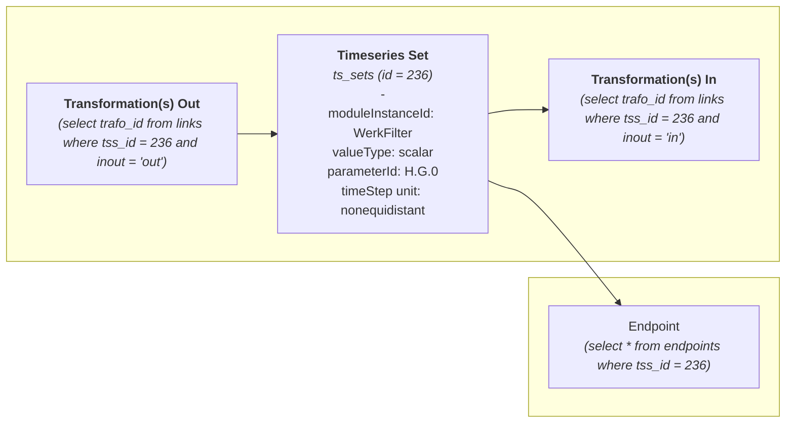
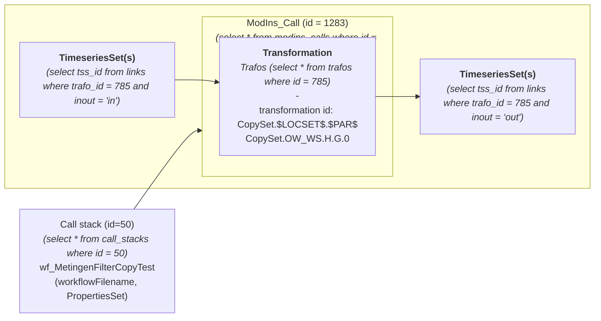

# Workplan

1. final goal: use an intelligent language model to talk with Delft-FEWS configuration and data. No need to implement any code related to this.
2. understand the current repository. It is about reading configuration used for delft-fews software. 
3. It ingest the structures of this configuration into a sqlite database.
4. It defines functions to read this structure for this sqlite database, such as the following two diagram with a focus on timeserieset or transformations:

**Focus on TimeSeriesSet**

**Focus on transformations**

Can you create a technical document explaining this repository.